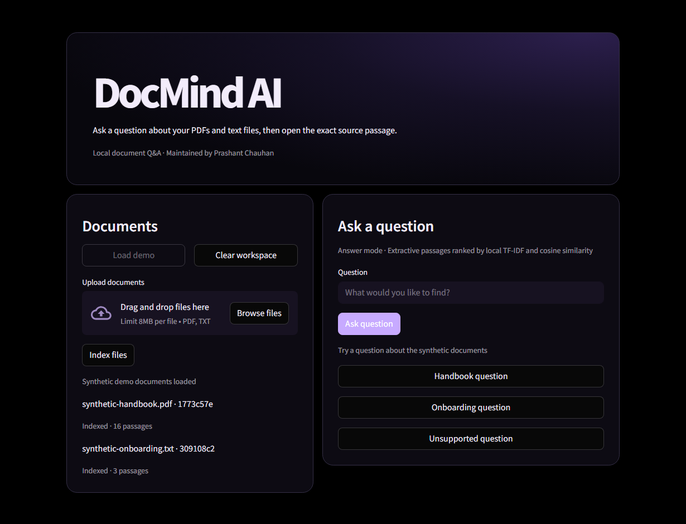
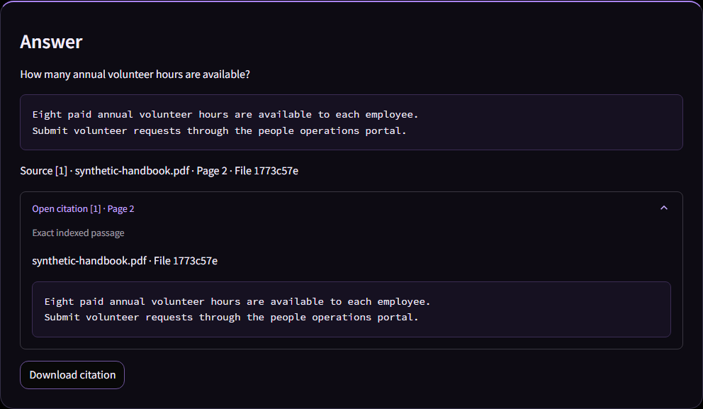
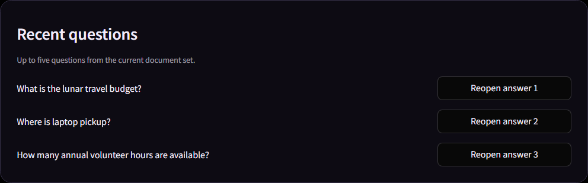

# DocMind AI

DocMind AI answers questions about PDFs and UTF-8 text files by returning an exact passage and its source location. It runs locally in Streamlit with a pure OLED-black dashboard, violet accents, and an expandable evidence panel.

**Author and maintainer** [Prashant Chauhan](https://github.com/itsprshnt20)

**Planned repository** [itsprshnt20/DocMind-AI](https://github.com/itsprshnt20/DocMind-AI)

## Screenshots

**Workspace with the synthetic demo indexed**



**PDF citation expanded to show the source passage**



**Recent questions panel**




## Features

- Index multiple PDFs and UTF-8 text files and see indexing status per document.
- Get a quoted extractive answer with a document ID, filename, and PDF page or text line range.
- Open the citation or download a TXT copy with the source filename, location, and document ID.
- Reopen up to five recent questions and their answers for the current document set.
- Clear documents, the index, and previous results with one action.

## Windows setup

Open PowerShell in the extracted project folder with 64-bit Python 3.11 installed.

```powershell
py -3.11 -m venv .venv
.\.venv\Scripts\python.exe -m pip install -r requirements.txt
.\.venv\Scripts\python.exe -m streamlit run app.py
```

Then open [the local dashboard](http://127.0.0.1:8501). Installation downloads the pinned dependencies from PyPI. The app uses the bundled sample files at runtime and needs no API key, models downloaded separately, or hosted service. Streamlit listens on loopback with its usage statistics disabled.

## Two-minute demo

1. Click **Load demo**. A synthetic company handbook PDF and a synthetic onboarding TXT file appear as indexed.
2. Enter **How many annual volunteer hours are available?** and click **Ask question**, or use **Handbook question**. The answer quotes the policy granting eight paid annual volunteer hours. Expand **Open citation [1] · Page 2** to see the exact extracted passage. Select **Download citation** to save it as TXT.
3. Click **Onboarding question** to ask **Where is laptop pickup?**. Open the citation to see the policy at **Lines 4–6**.
4. Click **Unsupported question** to ask about a lunar travel budget. The app says **I couldn’t find that in the uploaded documents.**
5. Open an earlier answer from **Recent questions**. Click **Clear workspace** to remove the uploaded or demo documents, index, and question history. To use your own files, choose **Upload documents**, select multiple PDF and TXT files, and click **Index files**.

## Architecture and answer method

```text
Synthetic files / uploads
          |
 Validate files and extract text (PyMuPDF / UTF-8)
          |
  Exact passages + file ID + page or line range
          |
  Session TF-IDF index <- Analyst question
          |
   Cosine similarity + lexical support checks
          |
   Best quoted passage + expandable citation
```

Paragraphs and long lines are split into chunks no longer than 900 characters. PDF provenance uses 1-based page numbers from PyMuPDF's sorted text extraction. TXT provenance uses 1-based physical line ranges after newline normalization. File IDs are independent of filenames. Two uploads with the same name can be cited separately.

The system ranks text with word-unigram and bigram TF-IDF and cosine similarity. A passage needs cosine similarity of at least 0.12 and at least 65% coverage of unique non-stopword query terms. It also needs two matched terms when the query has at least two. The highest-scoring qualifying passage is returned verbatim as extracted. These are retrieval rules, not measured accuracy. Text from documents is displayed as inert source material, and the app has no instruction execution or generation step.

## Tests

```powershell
.\.venv\Scripts\python.exe -m unittest discover -s tests -v
```

The optional browser smoke test requires a running app. Playwright downloads its Chromium headless shell and supporting tools during setup.

```powershell
.\.venv\Scripts\python.exe -m pip install playwright==1.65.2
.\.venv\Scripts\python.exe -m playwright install chromium --only-shell
.\.venv\Scripts\python.exe tests/browser_smoke.py
```

## Limitations

- The workspace accepts up to 10 files, 8 MiB per file, 200 pages per PDF, and 600,000 extracted characters per file. It rejects corrupt or encrypted PDFs. Scans need a text layer, and pages without extractable text are skipped when other pages contain text.
- Documents and the index live in the current Streamlit session. Clearing the workspace also resets the upload and question inputs. Indexing additional documents clears recent answers so they reflect the current document set. There is no persistent document store.
- PDF extraction can change reading order in multi-column layouts or tables. A citation quotes the extracted text, with the original page number for checking the PDF.
- Lexical matching can miss paraphrases or surface passages that contain the terms without resolving the question. It returns one passage per question and does not combine evidence across documents.

## GitHub handoff

**Repository description** Local document Q&A for PDFs and text files, with exact source passages and page or line citations.

**Resume bullet** Built a local Streamlit document Q&A app that indexes PDFs and UTF-8 text with TF-IDF and returns exact passages with page or line citations.

For a new empty repository, run these commands from the project folder after authenticating locally. If the target already has commits, inspect a clone first and add the audited files there so its history is preserved.

```powershell
git init -b main
git add .gitattributes .gitignore .streamlit/config.toml LICENSE README.md THIRD_PARTY_NOTICES.md app.py docmind.py requirements.txt requirements.lock.txt docs/screenshots samples/synthetic-handbook.pdf samples/synthetic-onboarding.txt tests
git diff --cached --check
git commit -m "Build DocMind AI local document Q&A"
git remote add origin https://github.com/itsprshnt20/DocMind-AI.git
git push -u origin main
```

## License

Original project code and synthetic demo material are covered by the [MIT License](LICENSE). Separately installed dependencies retain their own terms, including [PyMuPDF](THIRD_PARTY_NOTICES.md).
